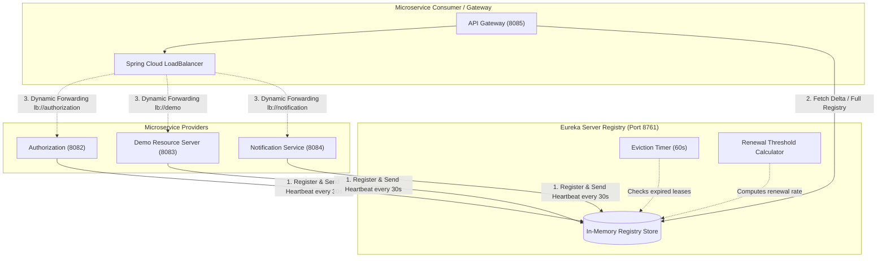
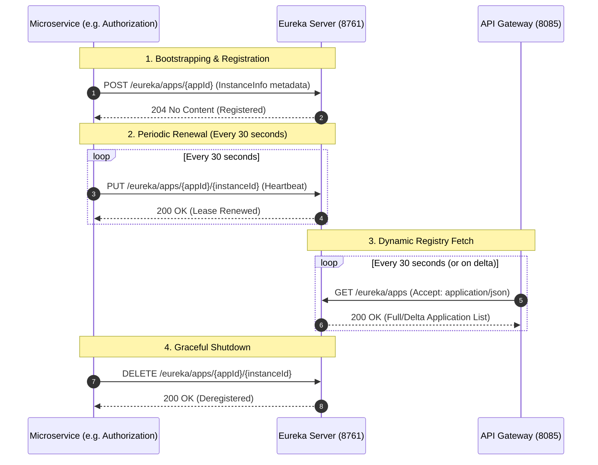
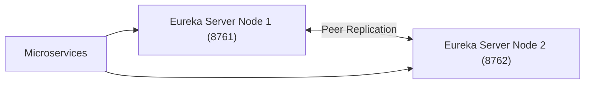

# Vaultix Eureka Server - Architecture & Service Discovery

Comprehensive technical manual and architectural guide for service registration, discovery, health tracking, client-side load balancing, and production configuration within the **Vaultix Eureka Server**.

---

## Table of Contents
1. [Ecosystem Role & Architecture](#1-ecosystem-role--architecture)
2. [Service Registration & Discovery Lifecycle](#2-service-registration--discovery-lifecycle)
3. [Concurrency Architecture: Java 27 Virtual Threads](#3-concurrency-architecture-java-27-virtual-threads)
4. [Self-Preservation Mode & Fault Tolerance](#4-self-preservation-mode--fault-tolerance)
5. [Registered Microservices Matrix](#5-registered-microservices-matrix)
6. [Downstream Client Microservice Configuration Guide](#6-downstream-client-microservice-configuration-guide)
7. [Eureka Server REST API Reference](#7-eureka-server-rest-api-reference)
8. [High Availability & Peer Replication](#8-high-availability--peer-replication)

---

## 1. Ecosystem Role & Architecture

In a distributed microservice topology like **Vaultix**, static hostnames and fixed IP addresses introduce coupling and complicate autoscaling. The **Eureka Server** provides dynamic, centralized runtime registration and service resolution.



### Core Responsibilities:
* **Service Registration**: Downstream microservices register their IP address, port, and health check endpoints immediately upon successful bootstrap.
* **Lease Management & Heartbeats**: Tracks instance health through heartbeats (default every 30 seconds). Unresponsive nodes whose leases expire are automatically evicted.
* **Client-Side Load Balancing**: Exposes registry deltas to the **Vaultix Gateway** and internal consumers, enabling dynamic client-side load balancing via `lb://<service-name>` without intermediary hardware load balancers.
* **Zero External Dependencies**: Operates entirely in-memory with optional peer replication, avoiding external database dependencies for the registry layer.

---

## 2. Service Registration & Discovery Lifecycle



### Lifecycle Stages:
1. **Registration**: When a microservice starts up, its Eureka Client sends a `POST` request containing host, port, health check URL, and custom metadata.
2. **Renewal (Heartbeat)**: Clients renew their lease every 30 seconds via a `PUT` request. If the server does not receive a heartbeat within 90 seconds (default), the instance becomes a candidate for eviction.
3. **Registry Fetch**: Consumers (such as the Gateway) fetch the registry table every 30 seconds and cache it locally for resilient offline lookups.
4. **Deregistration**: On graceful JVM shutdown (via Spring lifecycle hooks), the client dispatches a `DELETE` request, removing itself from the active routing pool immediately.

---

## 3. Concurrency Architecture: Java 27 Virtual Threads

The Vaultix Eureka Server runs on **Java 27** with **Project Loom Virtual Threads** enabled:

```yaml
spring:
  threads:
    virtual:
      enabled: true
```

### Why Virtual Threads Excel in Eureka:
* **Massive Concurrency**: Eureka is primarily an I/O-bound HTTP coordination service handling continuous incoming heartbeats, registration renewals, and registry fetch requests across all microservices and replicas.
* **Zero Thread Pool Exhaustion**: Traditional platform threads consume ~1 MB of stack memory and are bound to OS threads, limiting thread pools to several hundred. Virtual threads are lightweight user-mode threads managed by the JVM with negligible memory overhead (~few KB).
* **High-Throughput Heartbeat Handling**: When dozens of microservice instances send concurrent heartbeats every 30 seconds, virtual threads handle each connection without thread pool starvation or latency spikes.

---

## 4. Self-Preservation Mode & Fault Tolerance

Eureka features an intelligent safety mechanism called **Self-Preservation**:

### How It Works:
* If a network partition occurs, multiple microservices may still be running healthy but cannot reach the Eureka Server to deliver their 30-second heartbeats.
* Rather than evicting all instances and destroying cluster routing, Eureka monitors the ratio of actual renewals to expected renewals:
  $$\text{Expected Renewals per Minute} = \text{Registered Instances} \times \left(\frac{60}{\text{Renewal Interval in Seconds}}\right)$$
* If the renewal rate falls below the configured threshold (default: **85%**), Eureka triggers **Self-Preservation Mode**:
  - The server halts all automatic eviction of expired leases.
  - The web dashboard prominently displays: `EMERGENCY! EUREKA MAY BE INCORRECTLY CLAIMING INSTANCES ARE UP WHEN THEY'RE NOT`.
  - Once heartbeats return above the threshold, normal eviction resumes automatically.

### Configuration Tuning:
In local development environments with a single instance per service, self-preservation can occasionally delay rapid restarts. For local testing, it can be adjusted if needed:
```yaml
eureka:
  server:
    enable-self-preservation: true
    eviction-interval-timer-in-ms: 60000
    renewal-percent-threshold: 0.85
```

---

## 5. Registered Microservices Matrix

All microservices within the Vaultix platform adhere to the following naming conventions and port allocations:

| Service Name (`spring.application.name`) | Default Port | Health Indicator URL | Gateway Dynamic Route |
| :--- | :---: | :--- | :--- |
| **`gateway`** | `8085` | `http://localhost:8085/actuator/health` | Edge Proxy (`http://localhost:8085`) |
| **`authorization`** | `8082` | `http://localhost:8082/actuator/health` | `lb://authorization` (`/api/v1/auth/**`) |
| **`demo`** | `8083` | `http://localhost:8083/actuator/health` | `lb://demo` (`/api/v1/demo/**`) |
| **`notification`** | `8084` | `http://localhost:8084/actuator/health` | `lb://notification` (`/api/v1/notifications/**`) |

---

## 6. Downstream Client Microservice Configuration Guide

To register any Vaultix microservice (or third-party resource server) with the Eureka Server, follow this standard pattern:

### 1. Maven Dependency
Add `spring-cloud-starter-netflix-eureka-client` to the client's `pom.xml`:

```xml
<dependency>
    <groupId>org.springframework.cloud</groupId>
    <artifactId>spring-cloud-starter-netflix-eureka-client</artifactId>
</dependency>
```

### 2. Client `application.yaml` Configuration
```yaml
spring:
  application:
    name: authorization

eureka:
  client:
    service-url:
      defaultZone: ${EUREKA_CLIENT_SERVICE_URL_DEFAULTZONE:http://localhost:8761/eureka/}
    register-with-eureka: true
    fetch-registry: true
  instance:
    prefer-ip-address: true
    instance-id: ${spring.application.name}:${random.value}
    lease-renewal-interval-in-seconds: 30
    lease-expiration-duration-in-seconds: 90
```

### Configuration Rules for Clients:
* **`prefer-ip-address: true`**: Crucial in Docker, Kubernetes, and local environments to prevent unresolved container hostname issues.
* **`instance-id: ${spring.application.name}:${random.value}`**: Guarantees unique IDs for horizontally scaled multi-instance deployments.
* **`lease-renewal-interval-in-seconds: 30`**: Interval between outgoing heartbeat pings.
* **`lease-expiration-duration-in-seconds: 90`**: Window after which Eureka considers an unrenewed node dead.

---

## 7. Eureka Server REST API Reference

The Eureka Server exposes standard REST operations that can be queried directly (use `Accept: application/json` for JSON output):

| HTTP Method | Resource URI | Purpose |
| :--- | :--- | :--- |
| `GET` | `/eureka/apps` | Retrieve all registered applications and active instances. |
| `GET` | `/eureka/apps/{appId}` | Retrieve all instances of a specific application (e.g. `AUTHORIZATION`). |
| `GET` | `/eureka/apps/{appId}/{instanceId}` | Inspect metadata and status for a specific instance. |
| `POST` | `/eureka/apps/{appId}` | Register a new application instance. |
| `PUT` | `/eureka/apps/{appId}/{instanceId}` | Send a lease renewal heartbeat. |
| `PUT` | `/eureka/apps/{appId}/{instanceId}/status?value=OUT_OF_SERVICE` | Manually take an instance out of service for maintenance. |
| `PUT` | `/eureka/apps/{appId}/{instanceId}/status?value=UP` | Restore an instance to the active routing pool. |
| `DELETE` | `/eureka/apps/{appId}/{instanceId}` | Explicitly deregister an instance. |

### Querying from PowerShell:
```powershell
Invoke-RestMethod -Uri "http://localhost:8761/eureka/apps" -Headers @{ "Accept" = "application/json" }
```

---

## 8. High Availability & Peer Replication

In production multi-node deployments, Eureka servers replicate registry state bidirectionally across nodes without a central master.



### Production Peer Cluster Example:
```yaml
# Node 1 Profile
server:
  port: 8761
eureka:
  instance:
    hostname: eureka-node1.vaultix.internal
  client:
    register-with-eureka: true
    fetch-registry: true
    service-url:
      defaultZone: http://eureka-node2.vaultix.internal:8762/eureka/

---
# Node 2 Profile
server:
  port: 8762
eureka:
  instance:
    hostname: eureka-node2.vaultix.internal
  client:
    register-with-eureka: true
    fetch-registry: true
    service-url:
      defaultZone: http://eureka-node1.vaultix.internal:8761/eureka/
```
In this mode, any registration or heartbeat received by Node 1 is immediately forwarded to Node 2, ensuring zero downtime even if an entire availability zone fails.
